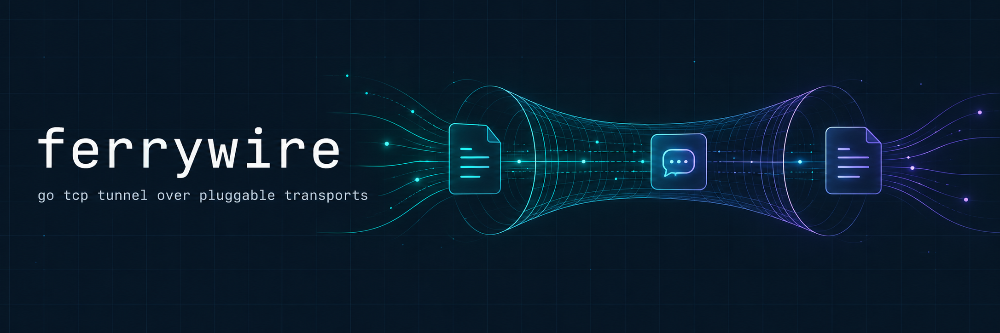

# ferrywire

TCP tunnel and SOCKS5 proxy with pluggable transports, written in Go.


ferrywire runs a local SOCKS5 proxy, terminates each connection in a
userspace TCP/IP stack, and carries the resulting packets to an exit node
over a pluggable transport. The included transports move packets through a
shared Yandex Docs session or a MAX messenger WebRTC call.

```
Browser / app --> SOCKS5 (client) --> transport --> exit node --> Internet
```

## Contents

- [Features](#features)
- [How it works](#how-it-works)
- [Install](#install)
- [Quick start](#quick-start)
- [Command line flags](#command-line-flags)
- [Transports](#transports)
- [Android and iOS](#android-and-ios)
- [Project layout](#project-layout)
- [Add a transport](#add-a-transport)
- [FAQ](#faq)

## Features

- SOCKS5 proxy on the client, so any browser or application can use it.
- Userspace TCP stack built on gVisor netstack, no TUN device or kernel
  changes on the client.
- Exit node that forwards decapsulated packets through a raw socket.
- Pluggable transports behind one small `Transport` interface.
- LZ4 compression wrapper around every transport.
- Automatic reconnects, batching of small packets, and clean shutdown on
  fatal transport errors.
- Structured logging with `log/slog` and a `--debug` switch.
- Single static Go binary for Linux, macOS, and Windows, plus an Android
  build script.

## How it works

1. The client starts a SOCKS5 server on `127.0.0.1:1080` by default.
2. Each SOCKS5 connection is terminated in a gVisor userspace TCP/IP stack,
   which turns the byte stream into IP packets.
3. Packets are compressed with LZ4 and handed to the selected transport.
4. The transport delivers them to the exit node through a third party
   service, for example by writing them into a shared Yandex Docs document.
5. The exit node injects the packets through a raw socket toward the real
   destination and sends the replies back the same way.

On Linux the exit node installs an `iptables` OUTPUT rule that drops outbound
RST packets, so the kernel does not tear down the tunneled connections.

## Install

With the Go toolchain, Go 1.26.4 or newer:

```bash
go install github.com/germanProgq/ferrywire@latest
```

Or build from source:

```bash
git clone git@github.com:germanProgq/ferrywire.git
cd ferrywire
go build -o ferrywire .
```

Requirements:

- Go 1.26.4+
- A Linux VPS with root access for the exit node
- Android NDK r27+ for the Android client build
- Xcode 26+ for the iOS client build

## Quick start

Run the exit node on your server. This needs root for the raw socket.

```bash
sudo ./ferrywire --exit-node --transport yandex --url "YOUR_YANDEX_DOC_URL" --debug
```

If the automatic `iptables` rule fails, add it by hand:

```bash
sudo iptables -I OUTPUT 1 -p tcp --tcp-flags RST RST -j DROP
```

Run the client on your machine:

```bash
./ferrywire --client --transport yandex --url "YOUR_YANDEX_DOC_URL" --socks5 127.0.0.1:1080 --debug
```

Point your browser or system SOCKS5 proxy at `127.0.0.1:1080`.

## Command line flags

| Flag          | Default          | Description                            |
|---------------|------------------|-----------------------------------------|
| `--exit-node` | `false`          | Run as exit node, needs root            |
| `--client`    | `false`          | Run as client                           |
| `--transport` | `yandex`         | Transport backend, `yandex` or `oneme`  |
| `--socks5`    | `127.0.0.1:1080` | SOCKS5 listen address                   |
| `--url`       | empty            | Document URL for the Yandex transport   |
| `--maxToken`  | empty            | MAX web auth token for the MAX transport|
| `--maxUid`    | empty            | MAX callee user ID for the MAX transport|
| `--debug`     | `false`          | Enable verbose debug logging            |

Exactly one of `--exit-node` or `--client` must be set.

## Transports

| Name     | Carrier                              | Needs                        |
|----------|---------------------------------------|-------------------------------|
| `yandex` | Yandex Docs editor cursor messages    | A shared document URL         |
| `oneme`  | MAX messenger WebRTC data channel     | MAX web token and callee ID   |

## Android and iOS

```bash
export ANDROID_NDK_HOME=<your Android NDK path>
./build_android.sh

export XCODE_PATH="<your Xcode.app path>"
./build_ios.sh
```

The iOS script builds a c-archive and needs a cgo export surface, meaning
`//export` functions. The current sources do not define one, so the script
aborts with guidance until you add it.

## Project layout

```
main.go              CLI, logging, wiring
socks5/              SOCKS5 server
transport/           Transport interface and LZ4 compression wrapper
transport/yandex/    Yandex Docs transport
transport/oneme/     MAX messenger transport
tunnel/              gVisor TCP tunnel, raw socket exit endpoint, checksums
```

## Add a transport

Implement the `Transport` interface from `transport/transport.go`:

```go
type Transport interface {
    Start() error
    Stop()
    Send(data []byte) error
    Receive(callback func([]byte))
    Fatal() <-chan error
}
```

Then register it in the transport switch in `main.go`.

## FAQ

**What is ferrywire?**
A SOCKS5 proxy and TCP tunnel written in Go that moves packets through
third party services such as Yandex Docs and MAX messenger.

**Does it need a TUN device or admin rights on the client?**
No. The client runs a userspace TCP/IP stack. Only the exit node needs root.

**Is it fast?**
It is bound by the carrier. Expect document and messenger rate limits to be
the bottleneck, which is why packets are batched and compressed.

**Which operating systems are supported?**
Linux, macOS, and Windows for the binary, Linux for the exit node, and
Android through the build script.
